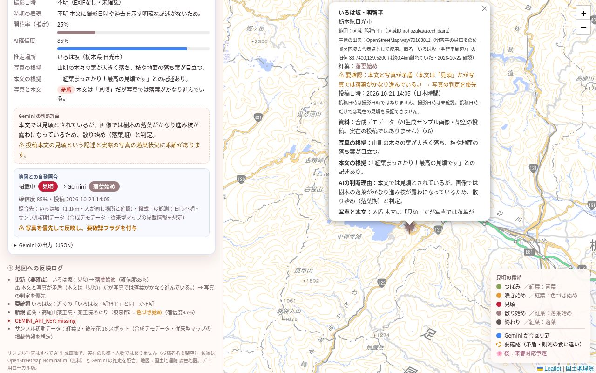
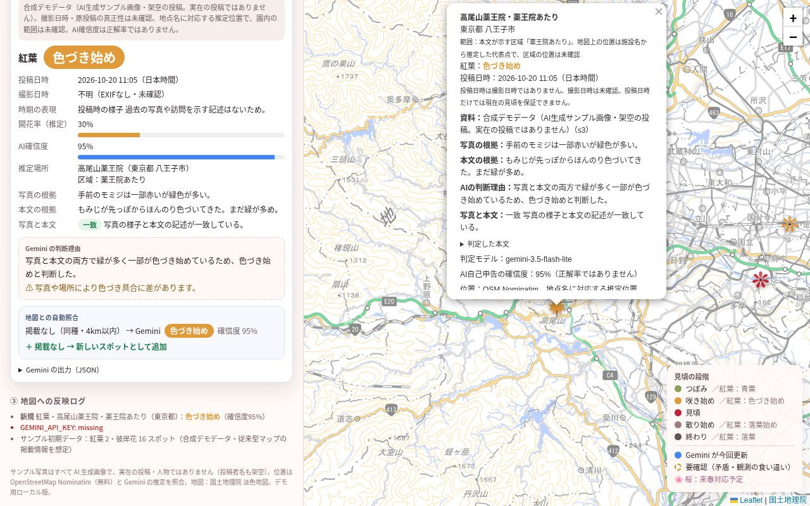
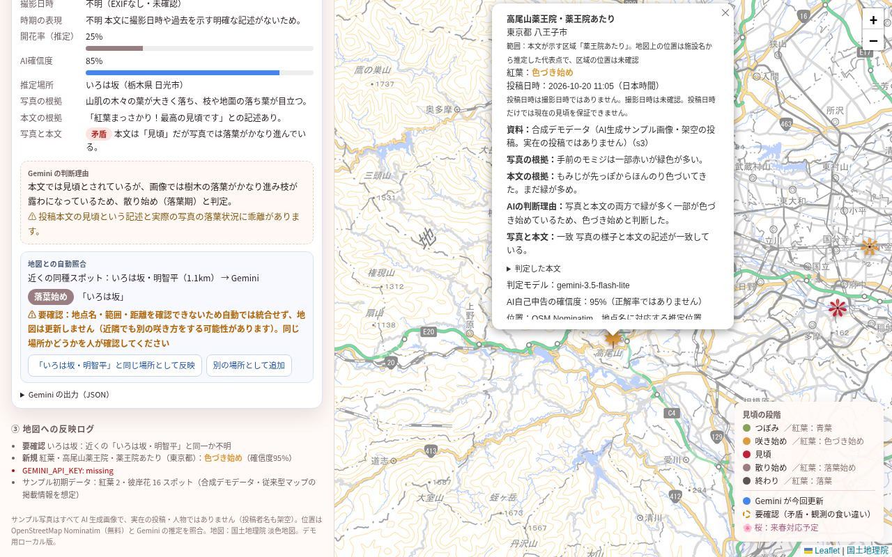
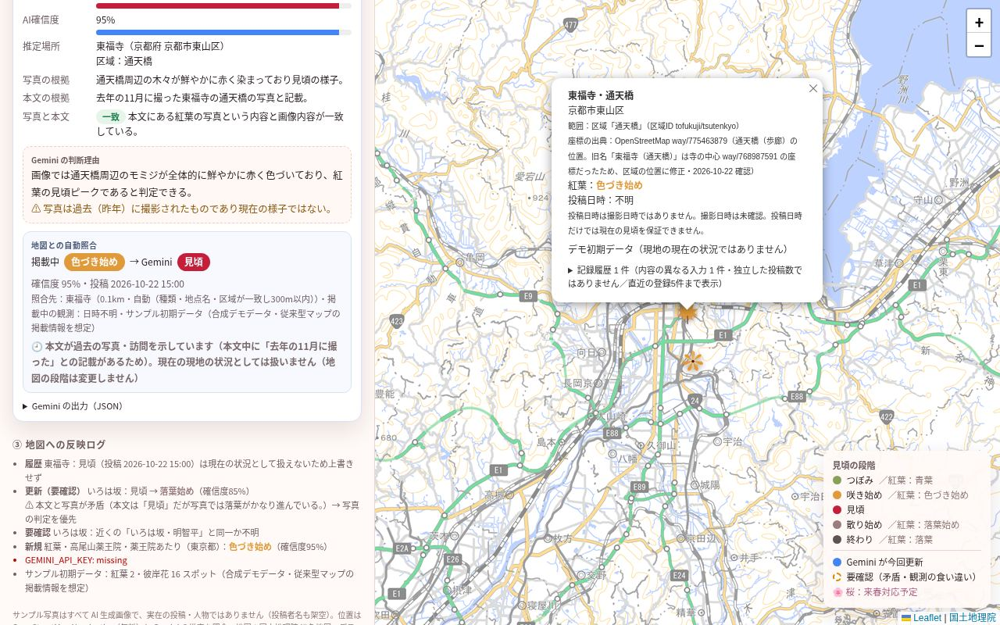

# みんなの"見頃"マップ / Migoro Map

**写真と本文を Gemini で解析し、地点・日時・根拠を確認しながら地図に反映する季節情報マップのデモです。**

表示する初期データと付属サンプルはすべて合成デモデータです。実際の現在の開花・紅葉状況を示すサービスではなく、SNS の自動収集も行いません。

🍁 紅葉・🌺 彼岸花のデモに対応しています。



スクリーンショットは合成データの保存済み解析結果を使った UI の例です。現在の現地状況や API の稼働確認を示すものではありません。

## なぜ作ったか
同じ公園でも、入口・斜面・日当たりによって見頃は異なることがあります。地域や施設全体の情報だけでは、訪れたい場所の状態を判断できない場合があります。

既存サービスにも地点別情報や現地写真があります。本作はそれらを否定・代替するものではなく、投稿の写真と本文を照合し、地点の範囲・投稿日時・根拠・不確実さを見えるようにする試作です。既存サービスより正確かどうかは、同地点・同時刻の現地記録との比較で今後検証します。

## これは何？
現地投稿（写真＋本文）を **Gemini API** が 1 件ずつ審査し、

- 種類（紅葉・彼岸花 など）と見頃の段階（つぼみ / 咲き始め / 見頃 / 散り始め / 終わり。紅葉は 青葉 / 色づき始め / 見頃 / 落葉始め / 落葉 と表示）
- 開花率・色づき率、確信度
- **写真と本文の整合性**（一致 / 一部不一致 / 矛盾）とその理由
- 地名・都道府県・市区町村・推定緯度経度、写真の根拠 / 本文の根拠 / 判断理由 / 注意点

を **構造化 JSON（responseSchema）** で返します。結果は**地図の掲載情報と自動で照合**され、

| 判定 | 地図への反映 |
|---|---|
| 同種・正規化後の地点名と園内の区域（area_detail）が完全一致・300m以内・同名候補が1件 | 投稿日時の新旧を確認して反映。300mは統合の保守的な上限で、測位精度ではありません |
| 4km以内に別名・範囲違い・同名の複数候補あり | 自動統合せず要確認。似た名前や施設名だけでは同一の観測区域とみなしません。人が「同じ場所として反映」「別の場所として追加」を選んだときだけ反映 |
| 4km以内に同種の候補なし | 推定位置に新しいスポットとして追加（撮影地点の確認ではありません） |
| 写真と本文が矛盾 | 写真の判定を優先して反映し、**要確認フラグ**（破線のリング）を付与 |
| 確信度 60% 未満 | 地図は更新せず**保留**（要確認） |
| 投稿日時が未来／本文が過去の写真・訪問を示す／EXIF の撮影日時が投稿より2日以上前 | 現在の段階は更新しない（既存地点には履歴として記録、新規地点は保留）。アップロードの未来日時は受け付けません |
| 同じ画像＋同じ本文の再投入 | 何も変えない（未解決の要確認も維持） |

デモの 3 つのシナリオ（すべて合成デモデータ。詳細は [samples/README.md](samples/README.md)）：

| (a) 根拠が十分 → 反映（s3 高尾山） | (b) 場所が曖昧 → 人が確認（s6 いろは坂） | (c) 過去の写真 → 反映しない（s8 東福寺） |
|---|---|---|
|  |  |  |

### Google AI の使い方
- 審査・判定の中核は **Gemini API（マルチモーダル入力＋構造化出力）** です。
- 使用モデルは `server.py` の設定に従います。`GEMINI_MODEL` で上書きできます。モデルの提供状況・利用上限・料金は、ご利用のアカウントで確認してください。

## 動かし方
必要なもの：Python 3.9+（標準ライブラリのみ）、ブラウザ。

1. [Google AI Studio](https://aistudio.google.com/apikey) で利用可能な API キーを用意し、利用条件・料金・データの取り扱いを確認してください。
2. 環境変数に設定して起動：
   ```bash
   export GEMINI_API_KEY="（あなたのキー）"
   python3 server.py
   ```
3. http://127.0.0.1:8765/ を開き、サンプル投稿を選んで「✦ Gemini で読み解く」を押します。写真のアップロードも可能です。

その他：
```bash
python3 server.py --cli s3 s6 s8               # 画面なしでデモのサンプルを判定（results/ に JSON 保存）
npm i playwright-core && node shoot.js         # ヘッドレスで全サンプルを順に実行し shots/ に画像と録画を保存（Chrome が必要。CHROME_PATH で指定可）
```

テスト（標準ライブラリのみ・実際の Gemini / Nominatim には接続しません）：
```bash
make test                                       # = 下の 2 つ
python3 -m unittest discover -s tests -v        # バックエンド（tests/test_server.py）
node --test tests/frontend.test.js tests/page.test.js   # フロントエンド（ロジック＋ページの実イベント、Node 18+）
```
- API キーは環境変数 `GEMINI_API_KEY` からのみ読み込みます。コードやログには出力しません。`.env.example` を参考にしてください（`.env` はコミットしないでください）。
- サーバーは `127.0.0.1` のみで待ち受けます（ローカル用デモ）。
- 解析時には画像と本文を Google の Gemini API に送信します。位置の推定には地名を Nominatim に送信します。個人情報・機密情報を含む写真や文章は入力しないでください。

## 素材・データについて
- `samples/` はすべて **合成デモデータ** です（AI 生成画像、架空の投稿者名 `@sample_*`・本文・投稿日時）。画面上の各カードにも「合成デモデータ」と表示しています。デモ用（`samples/samples.json`）と、異常系の回帰用（`samples/edge/`・画面に表示せず配信もしない）に分けています。→ [samples/README.md](samples/README.md)
- `seed.js` は、従来型の見頃マップに載っている情報を想定した **サンプル初期データ**（合成データ。紅葉 2・彼岸花 16 地点）です。実際の現在の状況を示すものではありません。各地点には、範囲（施設全体／園内の区域）と座標の出典を記録しています。一部の座標は OpenStreetMap の公開地物に基づきます（[座標の出典と限界](docs/evidence/seed-verification-2026-10-22.md)）。
- ジオコーディングに [OpenStreetMap Nominatim](https://nominatim.org/)（無料・キー不要）を使っています。[利用ポリシー](https://operations.osmfoundation.org/policies/nominatim/)に従い、**低頻度のデモ用途に限って**ご利用ください。データ © OpenStreetMap contributors（ODbL）。
- 地図タイル：[国土地理院 淡色地図](https://maps.gsi.go.jp/development/ichiran.html)（出典：国土地理院）。地図ライブラリ：[Leaflet](https://leafletjs.com/)。

## 地点と根拠の扱い
- 地図ポップアップには、デモ初期データ・AI 生成サンプル・アップロード資料の区別、投稿日時、写真と本文の根拠、AI の判断理由、位置推定元、直近の登録履歴を表示します。
- 投稿日時・撮影日時・分析日時は別の情報です。表示時刻は日本時間です。EXIF の撮影日時があっても未検証で、端末の時計に依存します。投稿から 3 日以上経過したものや日時不明のものは、現在の状況とは限らないと表示します。
- 原投稿 URL・写真の真正性・園内の正確な区域は確認していません。AI が返す確信度は正解率ではありません。施設の代表座標は撮影地点の確認ではありません。
- 地名の別名や施設全体と一部区域の対応を自動で推測しません。人が地点・区域を確認する必要があります。
- 履歴はページ内だけに保持され、再読み込みで初期状態に戻ります。表示は直近に登録した 5 件までです。重複判定は画像と本文のフィンガープリント、および投稿日時と段階に基づくため、入力件数は独立した証拠数ではありません。
- SNS 自動収集、原投稿 URL 検証、撮影日時の真正性検証、独立投稿数の集計、現地の正解データによる精度評価は未実装です。
- [オフライン回帰テスト用データ](docs/evidence/demo-2026-10-22/README.md)は、保存済みの合成サンプル解析結果です。現在の API の動作や精度を保証しません。

## 免責
これはアイデアを示すためのデモです。AI の判定は誤ることがあります。お出かけの際は必ず公式の開花・紅葉情報や現地の案内をご確認ください。Google の公式プロダクトではありません。

## ライセンス
[MIT](LICENSE) © 2026 teifurin
